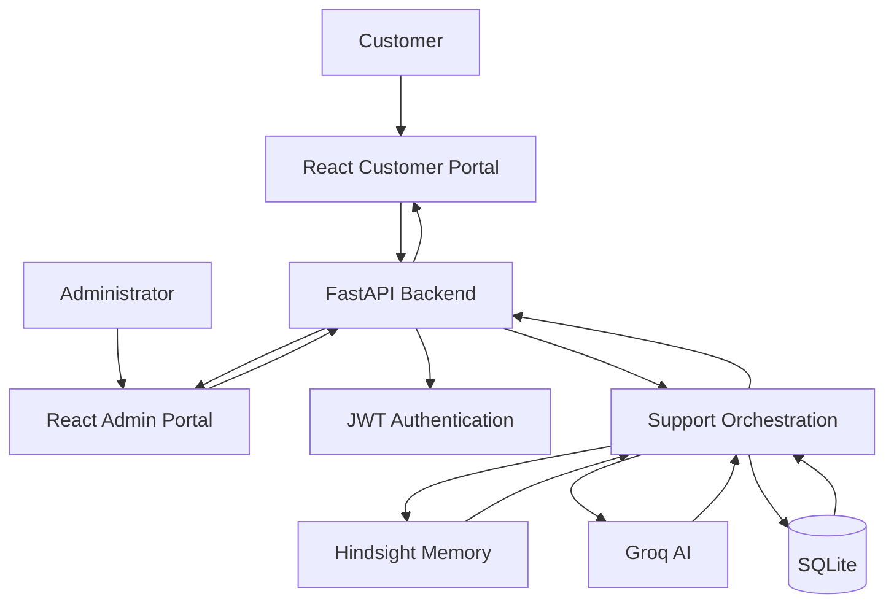
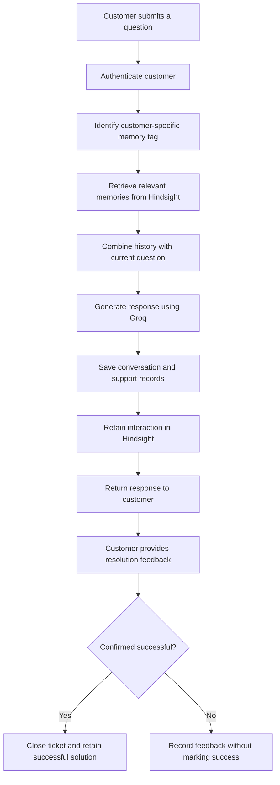
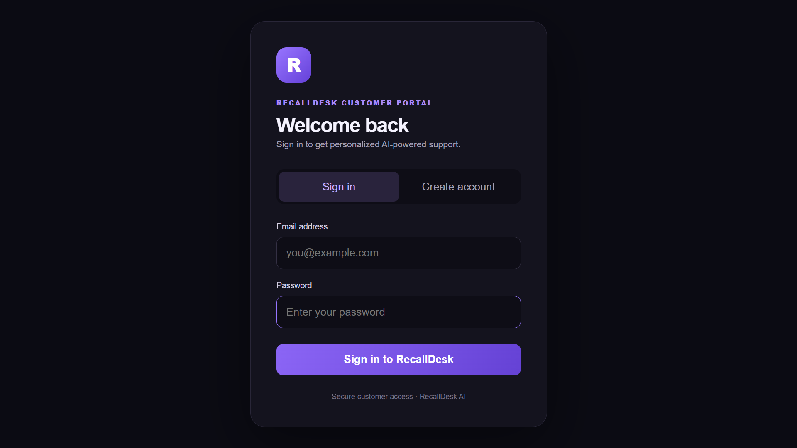
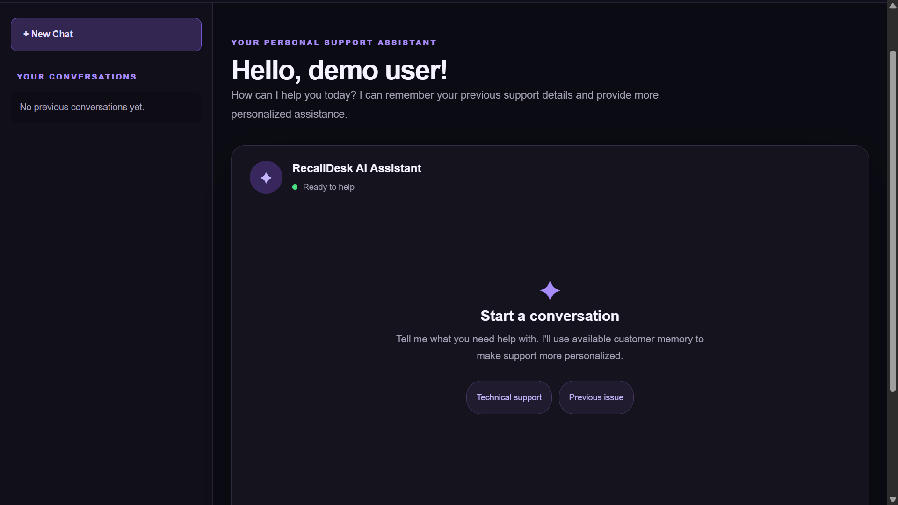
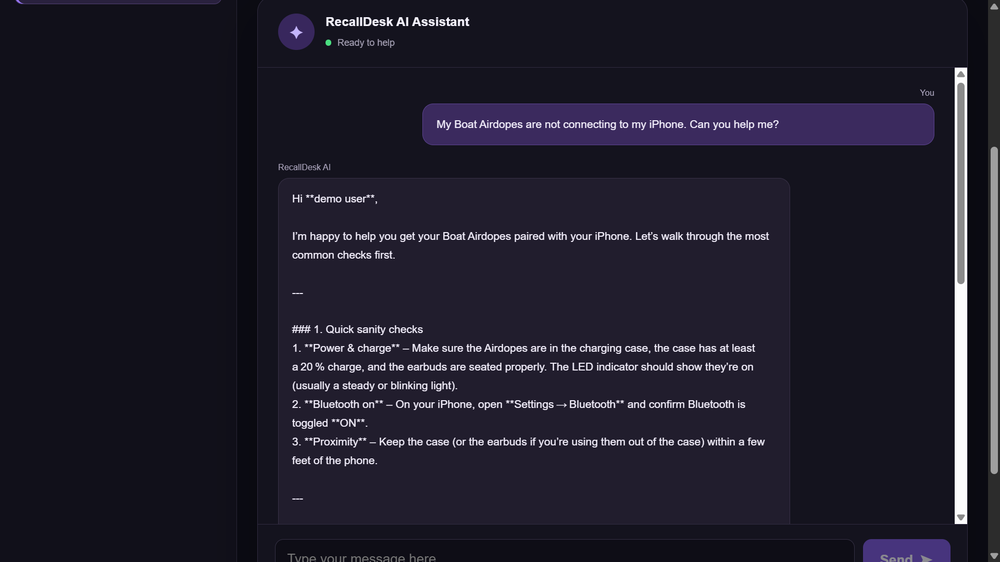
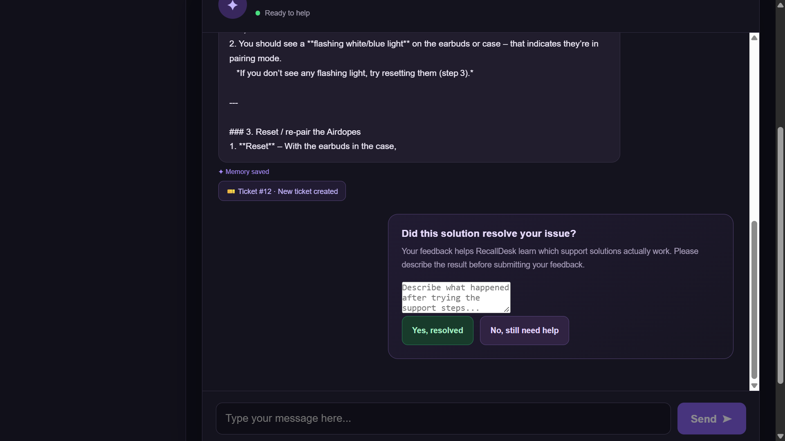
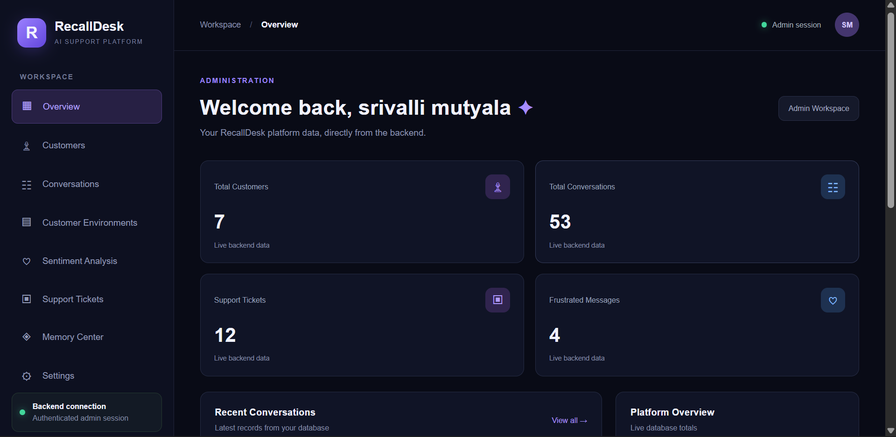
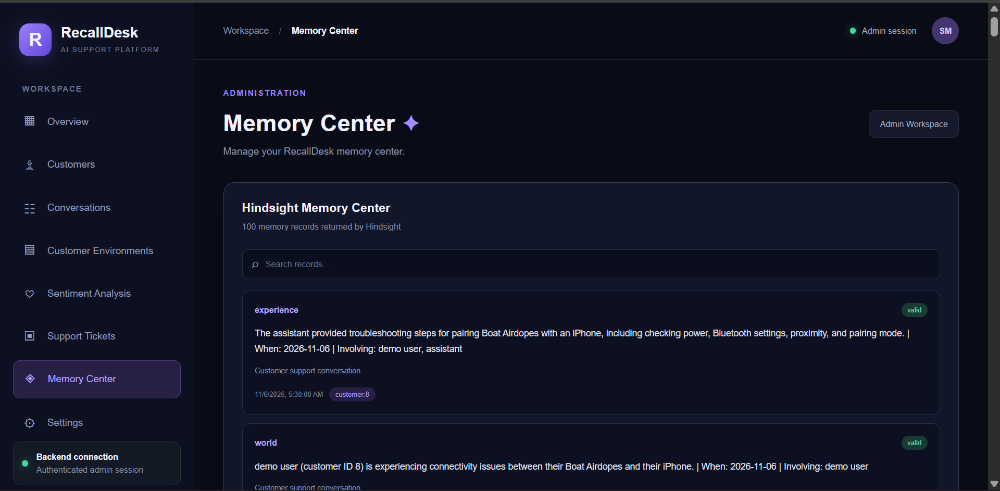

# RecallDesk
### Context-Aware AI Customer Support Powered by Persistent Memory

<p align="center">
  <strong>Support that remembers. Solutions that improve with every interaction.</strong>
</p>

<p align="center">
  
</p>

<p align="center">
  
  
  
  
  
  
</p>

---

## Overview

RecallDesk is an AI-powered customer support platform that brings persistent memory into conversational support.

Traditional chatbots often forget previous interactions, forcing customers to repeat their problems and troubleshooting history.

RecallDesk addresses this limitation by combining **Groq-powered AI response generation** with **Hindsight persistent memory**.

It retrieves relevant customer-specific support history, generates context-aware responses, records conversations, and retains customer-confirmed successful resolutions for future reference.

The goal is simple: make every support interaction contribute to a more continuous and informed customer experience.

## The Problem

Conventional AI support systems often struggle with:

- Repeated troubleshooting across conversations.
- Losing customer and device context.
- Suggesting steps that customers have already attempted.
- Failing to distinguish successful solutions from unsuccessful attempts.
- Limited visibility into support activity and outcomes.

## Our Solution

RecallDesk introduces a memory-driven support workflow.

Instead of treating every message as an isolated request, the platform retrieves relevant historical context before generating a response.

It also maintains structured support records and uses customer-confirmed resolution feedback to retain successful solutions.

## Key Features

### AI-Powered Customer Support
- Conversational support using Groq.
- Context-aware responses using retrieved customer memories.
- Persistent conversation history.
- Support ticket creation and tracking.

### Hindsight Persistent Memory
- Retains customer support interactions.
- Retrieves relevant historical troubleshooting context.
- Uses customer-specific memory tags.
- Supports strict tag-based memory retrieval.
- Retains customer-confirmed successful resolutions.

### Customer Portal
- Customer registration and authentication.
- AI support conversations.
- Conversation history.
- Resolution feedback.
- Browser and operating-system environment synchronization.

### Administrator Portal
- Operational dashboard.
- Customer management.
- Conversation inspection.
- Customer environment profiles.
- Sentiment analysis.
- Support ticket management and timelines.
- Hindsight Memory Center.

### Support Intelligence
- Rule-based sentiment analysis.
- Customer environment tracking.
- Resolution feedback records.
- Structured application data persistence.

## Technology Stack

| Category | Technology |
|---|---|
| Frontend | React, Vite |
| Backend | Python, FastAPI |
| AI response generation | Groq |
| Persistent memory | Hindsight |
| Database | SQLite |
| Authentication | JWT |
| Password security | pwdlib |
| API validation | Pydantic |

## System Architecture



## How RecallDesk Works



## What Makes RecallDesk Different?

**Memory beyond a single conversation.**

RecallDesk uses Hindsight as a dedicated persistent-memory layer rather than relying only on the current conversation.

**Customer-specific context.**

Memory retrieval is scoped using customer-specific tags and strict matching.

**Outcome-aware support.**

Customer-confirmed successful resolutions are retained separately from unsuccessful or unconfirmed attempts.

**AI plus structured support operations.**

The platform combines conversational intelligence with customer records, support tickets, resolution history, sentiment information, and administrative visibility.

## Project Structure

```text
RecallDesk/
|-- backend/
|   |-- auth.py
|   |-- auth_routes.py
|   |-- create_admin.py
|   |-- database.py
|   |-- environment.py
|   |-- main.py
|   |-- sentiment.py
|
|-- frontend/
|   |-- public/
|   |-- src/
|       |-- App.jsx
|       |-- CustomerPortal.jsx
|       |-- App.css
|       |-- CustomerPortal.css
|       |-- index.css
|       |-- main.jsx
|
|-- docs/
|   |-- ARCHITECTURE.md
|   |-- screenshots/
|
|-- .env.example
|-- .gitignore
|-- README.md
|-- requirements.txt
```

## Getting Started

### Prerequisites

- Python 3.12 or compatible version.
- Node.js and npm.
- Groq API credentials.
- Hindsight service credentials.

### 1. Clone the repository

```bash
git clone https://github.com/mutyalalakshmisrivalli/RecallDesk.git
cd RecallDesk
```

### 2. Configure the backend

Create a virtual environment:

```powershell
python -m venv .venv
.\.venv\Scripts\Activate.ps1
```

Install dependencies:

```bash
pip install -r requirements.txt
```

Create a root `.env` file using `.env.example` as a template.

Configure your own Hindsight and Groq credentials and the required authentication secret.

### 3. Start the backend

```bash
python -m uvicorn backend.main:app --reload
```

Backend:

`http://127.0.0.1:8000`

Interactive API documentation:

`http://127.0.0.1:8000/docs`

### 4. Start the frontend

Open another terminal:

```bash
cd frontend
npm install
npm run dev
```

Open the local URL displayed by Vite.

## API

RecallDesk exposes REST endpoints through FastAPI.

Some important API routes include:

| Method | Endpoint | Purpose |
|---|---|---|
| POST | `/auth/signup` | Customer registration |
| POST | `/auth/login` | Authentication |
| POST | `/support/message` | AI support conversation |
| GET | `/customer/conversations` | Customer conversation history |
| POST | `/customer/tickets/{ticket_id}/resolution` | Resolution feedback |
| GET | `/admin/dashboard` | Administrative overview |
| GET | `/admin/customers` | Customer management |
| GET | `/admin/memories` | Memory Center |
| GET | `/admin/tickets` | Support ticket management |

Explore the complete API through the Swagger interface at `/docs`.

## Security

RecallDesk includes JWT authentication, password hashing, role checks, customer ownership checks, and environment-based credential configuration.

**Never commit:**
- `.env` files.
- API keys or authentication secrets.
- Local database files.
- Virtual environments.
- Customer data or private backups.

Production deployment requires additional security hardening, including HTTPS, restricted CORS, rate limiting, and comprehensive authorization testing.

## Technical Documentation

For the detailed implementation and engineering design, see:

**[System Architecture & Technical Documentation](docs/ARCHITECTURE.md)**

It covers:
- System architecture.
- Hindsight memory lifecycle.
- Customer memory isolation.
- Support conversation workflow.
- Resolution-feedback mechanism.
- Database design.
- Authentication and authorization.
- API overview.
- Reliability and future improvements.

## Roadmap

- [ ] Automated memory retrieval quality evaluation.
- [ ] Expanded cross-customer isolation testing.
- [ ] Memory correction and deletion workflows.
- [ ] Advanced sentiment classification.
- [ ] Document and image-based customer support.
- [ ] Production deployment and monitoring.
- [ ] Expanded support analytics.

## Project Links

- **GitHub Repository:** [RecallDesk](https://github.com/mutyalalakshmisrivalli/RecallDesk)
- **Technical Documentation:** [Architecture](docs/ARCHITECTURE.md)
- **Hindsight:** [Official Documentation](https://hindsight.vectorize.io/)
- **Groq:** [Official Documentation](https://console.groq.com/docs)

---

<p align="center">
  <strong>RecallDesk</strong><br/>
  Remembering every interaction. Improving every support experience.
</p>
## Project Screenshots

### Customer Login


### Customer Portal


### AI Support Conversation


### Support Tickets


### Admin Dashboard


### Hindsight Memory Center



